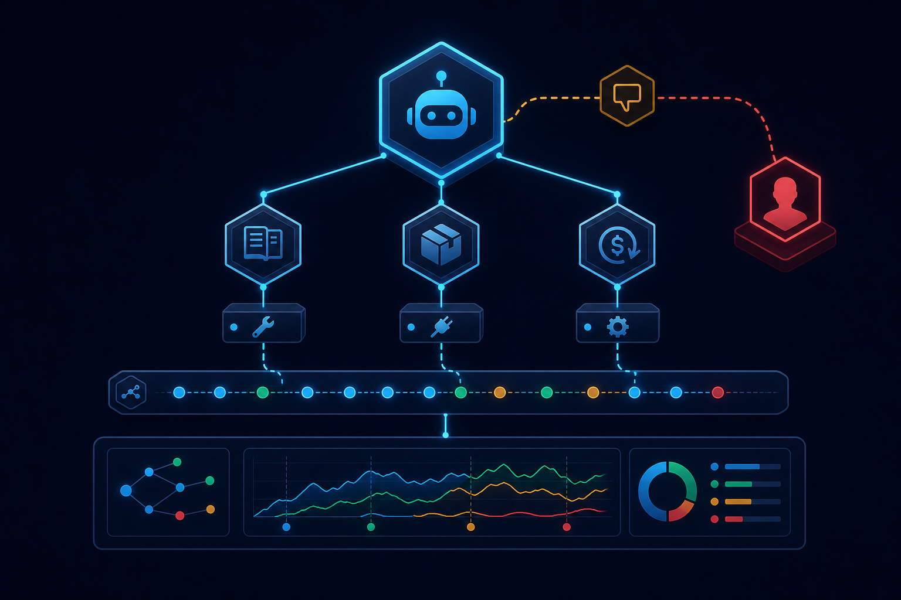
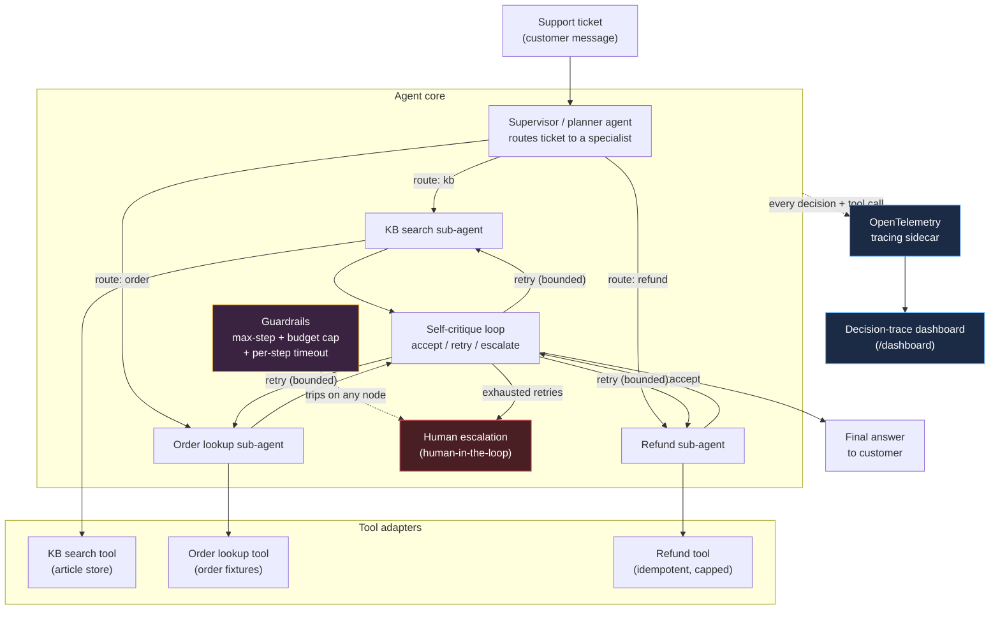

# agentops-sentinel

A supervisor/critique agent framework for support-ticket triage: bounded, observable and self-correcting.

[](https://github.com/SlateGitOrg/agentops-sentinel/actions/workflows/ci.yml)



## Why

Multi-step agent workflows tend to fail in three ways: one bad tool call derails the whole run, nobody can say afterwards why the agent took a given action, and a stuck retry loop can burn an unbounded number of LLM calls before anyone notices.

agentops-sentinel addresses all three in one concrete domain, support-ticket triage. A supervisor routes each ticket to a specialist sub-agent (knowledge base, order lookup or refunds). A self-critique pass reviews every result and decides to accept, retry or escalate to a human. Every decision and tool call becomes an OpenTelemetry span shown in a small trace dashboard. Hard guardrails (a step limit, a dollar budget and a per-step timeout) make sure each run terminates on budget even when tools fail.

## Features

- **Supervisor routing** to one of three specialists, or straight to human escalation for hostile, legal or ambiguous tickets.
- **Tool-using sub-agents**: keyword-ranked KB search, order-status lookup, and an idempotent refund processor that refuses to refund more than the order total.
- **Self-critique loop** that accepts, retries (bounded) or escalates based on confidence and tool errors.
- **Guardrails**: max steps, dollar budget charged per LLM/tool call, and a per-step timeout enforced in a worker thread.
- **Tracing**: every supervisor decision, agent run, critique and escalation is an OpenTelemetry span, kept in an in-process store and served at `/traces/{id}` and `/dashboard`.
- **Offline by default**: a deterministic `FakeLLMClient` runs the same control flow as a real model; Anthropic and OpenAI clients are optional.
- **Session store**: in-memory, or Redis when `AGENTOPS_REDIS_URL` is set.

## Architecture



**Reading it**: the supervisor is the only entry point — it inspects the ticket and picks exactly one specialist. That specialist calls its tool, and the result always passes through the self-critique loop before anything is returned to the customer. Retries loop back to the *same* specialist, bounded by both a per-task retry cap and the run's overall step/budget guardrails. Guardrail trips (budget exceeded, step limit hit, step timeout) short-circuit straight to human escalation from anywhere in the graph. Every node emits an OpenTelemetry span, mirrored into an in-process store that the `/dashboard` page renders as a timeline.

## Quick start

Requires Python 3.11+ (developed and tested on 3.13). Docker is optional.

```bash
python3.11 -m venv .venv && source .venv/bin/activate
pip install -r requirements-dev.txt
pip install -e .

# Run the tests (fully offline — no API keys, no Docker, no network)
pytest -q

# Run the API + dashboard
uvicorn agentops_sentinel.api.app:app --reload
# then open http://127.0.0.1:8000/dashboard
```

Submit a ticket and watch its trace appear on the dashboard:

```bash
curl -s -X POST http://127.0.0.1:8000/tickets \
  -H "content-type: application/json" \
  -d '{"ticket_text": "Where is my order ORD-1001?"}' | python -m json.tool
```

Or with Docker:

```bash
docker build -t agentops-sentinel .
docker run -p 8000:8000 agentops-sentinel
```

### Example

Four tickets against the default offline client, with the trace events trimmed:

```text
"Where is my order ORD-1001?"
  status=completed  route=order_agent  steps=3  cost=$0.07
  answer: Order ORD-1001 is currently 'delivered'. Tracking: 1Z999AA10123456784. Total: $129.99.

"How do I reset my password?"
  status=completed  route=kb_agent  steps=3  cost=$0.07
  answer: [KB-103] How to reset your password: To reset your password, click 'Forgot password' ...

"I want a refund for order ORD-1002"
  status=completed  route=refund_agent  steps=3  cost=$0.07
  answer: Refunded $59.50 for order ORD-1002 (processed).

"I will sue you, this is fraud"
  status=escalated  route=escalate  steps=1  cost=$0.03
  escalation_reason: supervisor_or_critique_requested_escalation
```

### Using a real LLM (optional)

By default everything runs against `FakeLLMClient` — a deterministic, keyword/heuristic reasoner that exercises the exact same control flow (routing, retries, escalation) as a real model, with zero network calls. To use a real model instead:

```bash
export AGENTOPS_LLM_PROVIDER=anthropic   # or "openai"
export ANTHROPIC_API_KEY=sk-ant-...      # or OPENAI_API_KEY
```

If the provider is set but the matching API key is absent, the system silently falls back to the fake client rather than failing — "offline by default" is the safe path.

## How it works

1. **Supervisor / planner** (`agents/supervisor.py`) reads the ticket text and routes it to exactly one of three specialists — `kb_agent`, `order_agent`, `refund_agent` — or straight to `escalate` if the ticket looks hostile, mentions legal action/fraud, or is too ambiguous to route confidently.
2. **Specialized sub-agents** (`agents/kb_agent.py`, `order_agent.py`, `refund_agent.py`) each own one real tool: a keyword-ranked knowledge-base search, an order-status lookup, and an idempotent refund processor that enforces "can't refund more than the order total." The refund agent chains both tools — it looks up the order total before refunding when the ticket doesn't specify an amount.
3. **Self-critique loop** (`agents/critique.py`) reviews every sub-agent result — its confidence score and whether its tool call errored — and decides `accept`, `retry` (bounded by `AGENTOPS_MAX_RETRIES_PER_TASK`), or `escalate`. Transient tool failures get one retry; permanent failures or persistently low confidence escalate instead of looping forever.
4. **Guardrails** (`guardrails.py`) wrap every node: a hard step-count ceiling (`AGENTOPS_MAX_STEPS`), a dollar budget charged per LLM/tool call (`AGENTOPS_BUDGET_USD`), and a per-step wall-clock timeout (`AGENTOPS_STEP_TIMEOUT_S`) run in a worker thread so a hung step can't hang the whole process. Any trip routes straight to human escalation.
5. **Tracing sidecar** (`tracing.py`) wraps every supervisor decision, sub-agent execution, critique review, and escalation as an OpenTelemetry span, mirrored into an in-process `DecisionTraceStore`. The FastAPI app (`api/app.py`) exposes it at `/traces/{id}` and renders it as a timeline at `/dashboard` — no OTel collector required to see a trace, though `configure_tracing(console_export=True)` or a real OTLP exporter can be added for production.
6. **Human escalation** is a first-class terminal state, not an error path: `/tickets/{id}` reports `status: "escalated"` with a structured `escalation_reason` (which guardrail tripped, or why the critique loop gave up), ready to hand off to a human agent.

### Project layout

```
src/agentops_sentinel/
  agents/        supervisor, kb/order/refund sub-agents, self-critique
  tools/         kb search, order lookup, refund (bundled fixtures, no DB/network)
  api/           FastAPI app (submit tickets, fetch runs/traces, dashboard)
  dashboard/     static decision-trace dashboard (vanilla HTML/JS)
  graph.py       the LangGraph StateGraph wiring it all together
  guardrails.py  step/budget/timeout guards
  tracing.py     OpenTelemetry sidecar + in-process trace store
  llm.py         LLMClient abstraction: FakeLLMClient (default) / Anthropic / OpenAI
  store.py       session/run store (in-memory, or Redis via fakeredis-tested code path)
  runner.py      AgentRunner — the public "run one ticket" entry point
tests/           pytest suite (offline); one real-Redis test is skipped unless a Redis URL is set
```

## Testing

The offline suite currently reports 84 passed, 1 skipped at 96% line coverage.

```bash
pytest -q                                    # full offline suite
pytest -q --cov=agentops_sentinel            # with coverage
pytest -q -m integration                     # optional: needs a real Redis (skipped by default)
```

The suite covers: tool successes/failures/edge cases, guardrail trips (budget, step limit, timeout), the deterministic LLM router and critique logic, full graph runs for every route (KB/order/refund), transient-tool-failure recovery via retry, permanent-tool-failure escalation, budget/step-exceeded escalation, direct supervisor escalation for hostile tickets, tracing span capture/isolation, the Redis-backed and in-memory session stores, and the FastAPI surface end-to-end.

## Limitations

- The tools run against small bundled fixtures (a few articles and orders); there is no real order, payment or helpdesk backend.
- The default `FakeLLMClient` is a keyword/heuristic reasoner. It makes the control flow reproducible, but it is not a measure of how a real model would route tickets.
- Runs are synchronous and in-process; there is no task queue or multi-worker deployment story.
- Traces live in an in-process store with a bounded size. For production, attach an OTLP exporter.

## License

MIT — see [LICENSE](LICENSE).
